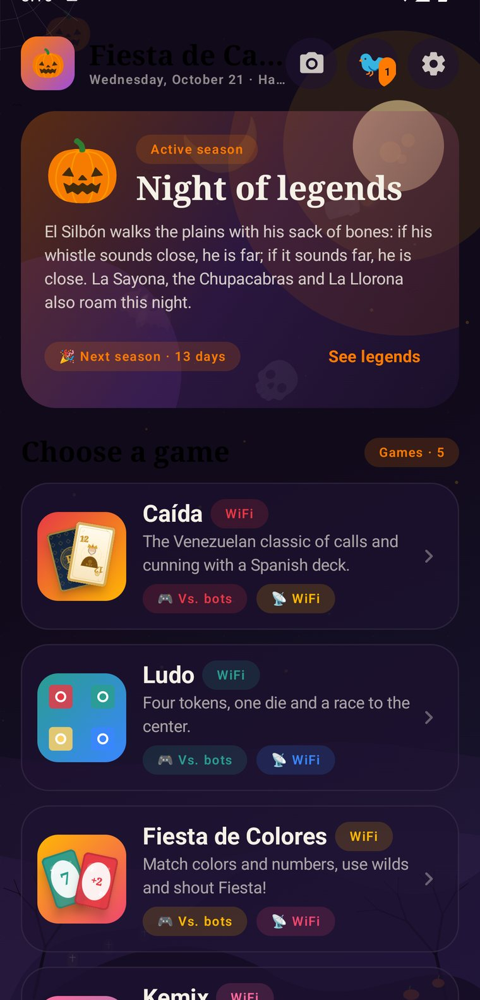
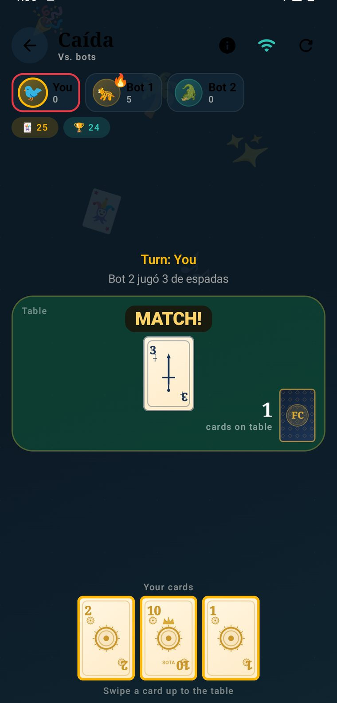
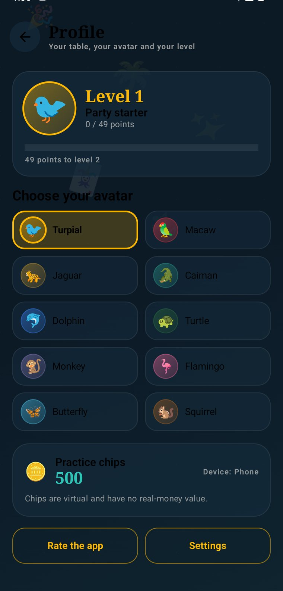

# Fiesta de Cartas 🃏🎉

[](https://github.com/emanuelindustri-source/fiesta-de-cartas/actions/workflows/android.yml)
[](https://emanuelindustri-source.github.io/fiesta-de-cartas/)
[](LICENSE)

App Android nativa de juegos de cartas y tablero con temática venezolana, arte original y multijugador por WiFi local.

- **Sitio web:** https://emanuelindustri-source.github.io/fiesta-de-cartas/
- **Descargar APK:** https://github.com/emanuelindustri-source/fiesta-de-cartas/releases/latest
- **Documentación legal:** [Privacidad](https://emanuelindustri-source.github.io/fiesta-de-cartas/privacy.html) · [Términos](https://emanuelindustri-source.github.io/fiesta-de-cartas/terms.html)
- **Contacto:** emanuel.industri@gmail.com

<p align="center">
  
  
  
</p>

## Juegos incluidos

| Juego | Modo | Descripción |
|---|---|---|
| **Caída** | Bots / WiFi | Clásico venezolano con baraja española de 40 cartas, cantos y puntos. |
| **Ludo** | Bots / WiFi | Cuatro fichas, un dado y carrera hasta el centro. |
| **Fiesta de Colores** | Bots / WiFi | Juego tipo UNO con colores, acciones, comodines y grito de ¡Fiesta! |
| **Kemix** | Bots | Juego de memoria: encuentra parejas de familias venezolanas. |
| **Nervioso** | Bots | Descarta, cuenta en voz alta y toca la pila primero. |

También incluye:

- **5 idiomas**: español (por defecto), inglés, portugués, italiano y chino. Detecta el idioma del teléfono y permite cambiarlo en Ajustes.
- **Temporadas automáticas** según la fecha del dispositivo: Fiesta venezolana, Halloween/Leyendas, Navidad, Reyes Magos, San Valentín, Pascua y Semana Santa. Se puede fijar una temporada manualmente y previsualizarla.
- **Leyendas venezolanas** (El Silbón, La Sayona, El Chupacabras, La Llorona) dentro de la temporada de Halloween.
- **Compartir la app por WiFi**: el teléfono anfitrión levanta un servidor local, muestra un QR y sirve su propia APK para que otro amigo la descargue e instale sin usar datos móviles.
- **Salas por WiFi**: el anfitrión crea la sala y muestra un QR; el invitado lo escanea con la cámara de la app. También se puede escribir IP, puerto y código.
- **Publicidad (AdMob)** con anuncios de prueba, consentimiento y anuncio intersticial cada 3 partidas terminadas.
- **Perfil con niveles 1–100**: cada partida da puntos de experiencia; ganar da más. La curva está pensada para durar meses y el progreso queda guardado en el teléfono.
- **10 avatares originales** inspirados en la fauna venezolana (turpial, guacamaya, jaguar, caimán, delfín, tortuga, mono, flamenco, mariposa y ardilla). Se eligen en el Perfil y reaccionan durante las partidas.
- **Reglas configurables** antes de cada partida: número de jugadores y puntos objetivo en Caída y Fiesta de Colores, fichas para ganar en Ludo y cartas iniciales en Nervioso.
- **Historial de partida** en los cinco juegos: las últimas 5 jugadas siempre visibles y un submenú con el historial completo, copiable al portapapeles.
- **Dificultad de bots** configurable: Relajado comete errores, Equilibrado juega bien y Desafiante castiga los descuidos.
- **Música y efectos en estéreo 44,1 kHz** con ambientes por temporada y sonidos de reparto, golpe, canto, dado, victoria y moneda.
- **Animaciones fluidas**: reparto, carta que vuela en Caída y Fiesta de Colores, volteo 3D de Kemix, mesa que tiembla, dado que rebota y fichas con volumen.
- **Baraja y tablero con acabado**: papel envejecido, figuras ilustradas, marco de Ludo con perspectiva y sombras, monedas dibujadas y nuevo icono/logo de la app.
- **Temporadas en toda la app**: octubre se vive como Halloween en el fondo, los menús, los títulos, las partículas, los sonidos y los textos. Navidad, Reyes, San Valentín, Pascua y Semana Santa tienen su propia escena y ambiente sonoro.
- **Arte renovado**: baraja española con papel envejecido, esquinas ornamentadas, pips reales y figuras de Rey, Caballo y Sota; cartas de colores con brillo, dado 3D, tablero de Ludo con marco de madera, estrellas y fichas con volumen, y monedas dibujadas.
- **Sonido ambiental por temporada** y efectos de reparto, golpe, canto, dado, victoria y moneda. Se apaga desde Ajustes.
- **Modo sin bots** (pasar el teléfono) en los cinco juegos, además de bots y WiFi.
- **Apoyo opcional con Honeygain**: solo si el usuario acepta, comparte ancho de banda mientras juega; se puede desactivar y nunca corre en segundo plano. Requiere descargar la AAR y configurar la clave (ver `docs/HONEYGAIN.md`).
- **Calificar la app** desde Perfil o Ajustes: estrellas, categorías y comentario que se envían por correo a `emanuel.industri@gmail.com` usando la app de correo del teléfono.
- **Detección de dispositivo** (teléfono, tablet, TV o doble pantalla) y diseño adaptable; en TV se puede navegar con el mando.
- **Ajustes**: idioma, tema/temporada, color dinámico según el fondo de pantalla, sonido, vibración, estadísticas y privacidad.

## APK lista para instalar

- Ruta: `app/build/outputs/apk/release/app-release.apk`
- Paquete: `com.fiestadecartas.app`
- Versión: `1.3.1` (versionCode 5)
- Compatible con Android 7.0 o superior (API 24+); probada en Android 14 (API 34).
- Firma: certificado de producción `CN=Fiesta de Cartas`, creado con el keystore `fiesta-release.jks`.
- SHA-256 del APK: `FC934B5F4213A4C3C0DA3E97D839B5E12303259BD90548CF83D120F88433CE0B`
- Tamaño: 35.370.398 bytes (35,4 MB).

### Instalar en un teléfono

1. Copia `app-release.apk` al teléfono (cable USB, Google Drive, WhatsApp o por el QR de la propia app).
2. Abre el archivo desde el explorador de archivos.
3. Si Android lo pide, activa **Instalar apps desconocidas** para esa app (Archivos, Chrome o WhatsApp).
4. Acepta la instalación y abre **Fiesta de Cartas**.

> Si ya hay una versión instalada con otra firma, Android pedirá desinstalarla primero. La versión `debug` y la `release` pueden convivir porque la debug usa el paquete `com.fiestadecartas.app.debug`.

## Compartir la app con amigos por WiFi

1. Ambos teléfonos deben estar en la **misma red WiFi** (o el anfitrión activa su punto de acceso).
2. En el teléfono que ya tiene la app: **Ajustes → Compartir la app** (o el botón de compartir en la pantalla principal).
3. Pulsa **Iniciar servidor**. Aparecerá un QR y una dirección tipo `http://192.168.x.x:PUERTO/`.
4. El amigo escanea el QR con la cámara del teléfono o escribe la dirección en el navegador.
5. Descarga la APK, permite la instalación desde esa fuente y abre la app.

Notas:

- La descarga funciona por la red local; no consume datos móviles.
- Algunos routers con **aislamiento de clientes** (AP isolation) impiden que los teléfonos se vean. En ese caso usa el punto de acceso del anfitrión o desactiva esa opción en el router.
- El servidor se detiene al salir de la pantalla o cerrar la app.

## Jugar por WiFi

1. Abre un juego compatible (Caída, Ludo o Fiesta de Colores).
2. Elige **Con amigos (WiFi)**.
3. **Anfitrión**: escribe tu nombre y pulsa **Crear sala**. Se muestra un QR, la IP, el puerto y un código de 4 dígitos.
4. **Invitado**: pulsa **Escanear QR** y apunta al QR del anfitrión, o escribe IP, puerto y código y pulsa **Unirme**.
5. Cuando el invitado aparezca como conectado, el anfitrión pulsa **Iniciar partida**.

Detalles del modo WiFi:

- El anfitrión es la autoridad de la partida; las acciones se sincronizan por la red y los bots los ejecuta el anfitrión.
- Hay soporte para **un invitado por sala**; el resto de asientos se completan con bots (Ludo: 4 jugadores; Caída y Fiesta: según las reglas configuradas, de 2 a 4; Kemix y Nervioso: 4).
- Todos los juegos tienen modo WiFi, modo contra bots y modo sin bots en el mismo teléfono.
- Si se pierde la conexión, el invitado vuelve al inicio con un aviso.
- Probado en Android 14 con dos dispositivos en Caída: invitado conectado, inicio de partida y acciones en ambos sentidos. Kemix y Nervioso usan el mismo protocolo de acciones; conviene probarlos en dos teléfonos reales antes de un torneo.

## Perfil, niveles y avatares

- Toca el avatar de la esquina superior derecha (o **Ajustes → Perfil**) para ver el nivel, la barra de progreso y las fichas de práctica.
- Cada partida terminada suma puntos: **90** si ganas y **45** si pierdes. Los niveles van del 1 al 100 y cada uno pide más puntos que el anterior.
- Los avatares son cosméticos y se guardan en el teléfono. No requieren cuenta.
- Las **fichas de práctica** son virtuales: no se compran, no se cambian por dinero y no tienen valor monetario.

## Reglas configurables

Al tocar una tarjeta de juego aparece la configuración de la partida:

| Juego | Opciones |
|---|---|
| Caída | 2, 3 o 4 jugadores; 24, 30 o 50 puntos para ganar |
| Fiesta de Colores | 2, 3 o 4 jugadores; 200, 300 o 500 puntos |
| Ludo | 4 jugadores; 2, 3 o 4 fichas para ganar |
| Nervioso | 5, 7 o 9 cartas iniciales |
| Kemix | 6 parejas y 4 jugadores |

El anfitrión usa el número de jugadores elegido al crear la sala WiFi.

## Historial de la partida

- Mientras juegas, la franja **Últimas jugadas** muestra los cinco movimientos más recientes.
- El botón de historial (o **Ver todo**) abre el registro completo de la partida, con la opción de copiarlo al portapapeles.
- El historial se reinicia al empezar una partida nueva y no se envía a ningún servidor.

## Dificultad de los bots

Antes de empezar puedes elegir:

| Nivel | Comportamiento |
|---|---|
| **Relajado** | Comete errores a propósito; ideal para aprender o jugar con niños. |
| **Equilibrado** | Juega bien, pero deja oportunidades. Es el nivel por defecto. |
| **Desafiante** | Prioriza capturas, seguridad y puntos; castiga los descuidos. |

La dificultad se guarda y se aplica a Caída, Ludo, Fiesta de Colores, Kemix y Nervioso.

## Calificar la app y comentarios

En **Perfil → Calificar la app** o **Ajustes → Calificar la app** se eligen de 1 a 5
estrellas, categorías (diversión, diseño, errores, ideas) y un comentario. Al pulsar
**Enviar por correo** se abre la app de correo del teléfono con el mensaje ya escrito
para `emanuel.industri@gmail.com`. La app no envía nada por su cuenta ni guarda el
comentario en un servidor.

## Pantallas y dispositivos

La app detecta si corre en teléfono, tablet, televisor o dispositivo de doble
pantalla y adapta el ancho del contenido. En televisores, el primer juego recibe el
foco para poder navegar con el mando (D-pad) además del toque. La información del
dispositivo aparece en **Ajustes → Apariencia**.

## Apoyo opcional con Honeygain

La app tiene una tarjeta **Ajustes → Apoyar la app** para que el usuario decida si
quiere compartir ancho de banda sin usar mientras juega. Está desactivada por
defecto, usa el consentimiento oficial de Honeygain y solo corre con la app abierta.
La integración está en `data/HoneygainSupport.kt`.

El SDK es propietario y **no se incluye en el repositorio**. Para activarlo:

1. Descarga `hgsdk.aar` desde el panel de Honeygain y colócalo en `app/libs/`.
2. Añade `honeygain.apiKey=...` a `local.properties` (ignorado).
3. Recompila la APK.

Sin esos dos pasos la tarjeta muestra “SDK no disponible” y el resto de la app
funciona igual. Honeygain no permite su SDK en apps de Google Play. Guía completa:
[`docs/HONEYGAIN.md`](docs/HONEYGAIN.md).

## Dinero real: estado actual

La app **no mueve dinero real**. Las fichas son de práctica y no se pueden comprar
ni canjear. El diseño y los requisitos legales para una futura billetera con
bolívares/USDT están documentados en [`docs/ONLINE_ROADMAP.md`](docs/ONLINE_ROADMAP.md);
habilitar apuestas reales exige licencia, KYC/AML, pasarela de pagos y cumplimiento
de las políticas de Google Play.

## Temporadas, temas e idiomas

- La temporada se calcula con la fecha del dispositivo. En **Ajustes → Tema y temporada** se puede dejar en automático o fijar una.
- Los colores pueden adaptarse al fondo de pantalla con **Color según mi fondo de pantalla** (Android 12+).
- El idioma se puede dejar en automático o forzar desde **Ajustes → Idioma**.
- Las reglas completas de cada juego están dentro de la partida, en el botón de información.

## Publicidad y AdMob

La app incluye AdMob con **IDs de prueba de Google**. La cuenta de AdMob ya está
aprobada con el ID de editor `pub-7330148989868278`; el archivo `site/app-ads.txt`
ya contiene esa línea para cuando se use un dominio propio. Faltan los IDs de la app
y de los bloques (se copian desde el panel de AdMob, no la contraseña).

Los IDs de prueba **no generan ingresos** y deben sustituirse antes de publicar:

1. Entra a [AdMob](https://admob.google.com/) con la cuenta de contacto del proyecto y crea la app `Fiesta de Cartas` (Android, paquete `com.fiestadecartas.app`).
2. Crea un **bloque de anuncios de banner** y uno **intersticial**.
3. Reemplaza los valores en `app/src/main/java/com/fiestadecartas/app/ads/Ads.kt`:

```kotlin
object AdsConfig {
    const val APP_ID = "ca-app-pub-XXXXXXXXXXXXXXXX~YYYYYYYYYY"
    const val BANNER_ID = "ca-app-pub-XXXXXXXXXXXXXXXX/1111111111"
    const val INTERSTITIAL_ID = "ca-app-pub-XXXXXXXXXXXXXXXX/2222222222"
}
```

4. Reemplaza también el `APPLICATION_ID` en `app/src/main/AndroidManifest.xml` (meta-data `com.google.android.gms.ads.APPLICATION_ID`).
5. Vuelve a compilar y firma la APK.

Sin esos cambios, la app seguirá mostrando anuncios de prueba y no habrá ingresos.

> **Credenciales:** no guardes la contraseña de la cuenta de Google en el proyecto,
> en capturas ni en el chat. Crea los bloques desde AdMob con la cuenta iniciada en
> el navegador y pega solo los IDs públicos. Si la contraseña se compartió, cámbiala
> y activa la verificación en dos pasos.

Para comparar AdMob con AppLovin MAX, Unity LevelPlay, Honeygain y otras opciones,
consulta [`docs/MONETIZATION.md`](docs/MONETIZATION.md).

## Estructura del repositorio

```text
FiestaDeCartas/
├── app/                     # App Android (Kotlin + Jetpack Compose)
│   └── src/main/
│       ├── java/...         # Motores, pantallas, red LAN, datos y UI
│       └── res/             # Traducciones (5 idiomas), temas e iconos
├── site/                    # Sitio web estático (GitHub Pages)
│   ├── index.html
│   ├── styles.css
│   ├── app.js               # Cambio ES/EN, menú y animaciones
│   ├── privacy.html
│   ├── terms.html
│   └── assets/              # Logo, capturas, imagen Open Graph
├── docs/
│   ├── ADMOB.md             # Activar los IDs reales de AdMob
│   ├── ARCHITECTURE.md      # Capas, protocolo LAN y decisiones técnicas
│   ├── HONEYGAIN.md         # SDK opcional de ancho de banda
│   ├── MONETIZATION.md      # Anuncios, tiendas, Honeygain y pagos
│   └── ONLINE_ROADMAP.md    # Diseño futuro de torneos y dinero real
├── .github/workflows/       # CI Android, release firmada y Pages
├── fiesta-release.jks       # NO se sube (ignorado)
├── keystore.properties      # NO se sube (ignorado)
└── README.md
```

### Sitio web

El sitio vive en `site/` y no necesita compilación. Para verlo en local:

```powershell
python -m http.server 8080 --directory site
```

Abre `http://localhost:8080`. GitHub Pages lo publica automáticamente desde
`site/` con el workflow **Deploy website** en cada push a `main`.

## Compilar desde cero

Requisitos:

- JDK 17 (`JAVA_HOME` apuntando al JDK 17).
- Android SDK con plataforma 34 y build-tools 34.0.0.
- Variables `ANDROID_HOME` / `ANDROID_SDK_ROOT` configuradas.

```powershell
cd FiestaDeCartas
.\gradlew.bat :app:assembleDebug --no-daemon --console=plain
.\gradlew.bat :app:assembleRelease --no-daemon --console=plain
```

Salidas:

- Debug: `app/build/outputs/apk/debug/app-debug.apk` (`com.fiestadecartas.app.debug`)
- Release firmada: `app/build/outputs/apk/release/app-release.apk`

### Firma

- Keystore: `fiesta-release.jks` (en la raíz del proyecto, **ignorado por Git**).
- Alias: `fiesta`.
- Las contraseñas se leen de `keystore.properties` (ignorado) o de las variables
  `RELEASE_STORE_FILE`, `RELEASE_STORE_PASSWORD`, `RELEASE_KEY_ALIAS` y
  `RELEASE_KEY_PASSWORD`. Nunca se guardan en el repositorio.

**Importante:** guarda `fiesta-release.jks` y sus contraseñas en un lugar seguro
(gestor de contraseñas y copia cifrada). Sin ese archivo no se pueden publicar
actualizaciones que se instalen encima de la versión actual. No compartas el
keystore ni lo subas a un repositorio público.

Verificar la firma:

```powershell
& "$env:ANDROID_HOME\build-tools\34.0.0\apksigner.bat" verify --print-certs app\build\outputs\apk\release\app-release.apk
```

## Privacidad y permisos

La app no pide registro ni crea cuentas. Usa:

- **Cámara**: solo para escanear QR de salas y de descarga.
- **Internet / estado de red / WiFi**: salas LAN, descarga de la APK y anuncios.
- **Vibración**: opcional, se puede desactivar.

No se suben partidas ni datos personales a ningún servidor propio. AdMob puede recopilar datos según el consentimiento que el usuario acepte o rechace en el primer arranque.

## Limitaciones conocidas

- Los comentarios generados por los motores de juego (por ejemplo, “Bot 2 jugó…”) están en español aunque la interfaz esté en otro idioma.
- El modo WiFi permite un invitado por sala; el resto son bots.
- La primera vez que se comparte la APK, Android puede pedir permiso para instalar apps desconocidas; es normal en una app fuera de Google Play.
- Los anuncios son de prueba hasta sustituir los IDs de AdMob.

## Antes de publicar en Google Play

1. Sustituir los IDs de AdMob y volver a firmar.
2. Crear la ficha de la app, política de privacidad y declaración de datos.
3. Revisar la política de Google Play sobre apps que comparten su propia APK (la función está pensada para uso entre amigos fuera de la tienda; para Play puede ocultarse o justificarse).
4. Subir un **App Bundle (.aab)** en lugar de la APK, o mantener la APK para distribución directa.
5. Probar en al menos dos teléfonos reales la sala WiFi, el escaneo de QR y la descarga de la APK.

## Contacto

- Autor: Emanuel
- Correo de contacto: `emanuel.industri@gmail.com`
- Hecho con cariño para Venezuela y el mundo.

> Nota de seguridad: si compartiste la contraseña de tu cuenta de Google en algún chat, cámbiala cuanto antes y activa la verificación en dos pasos. Esta app no almacena ni utiliza esa contraseña; el correo solo aparece como dato de contacto.
